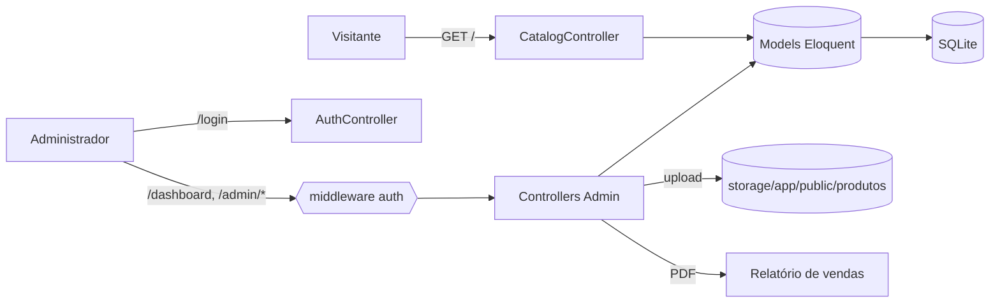
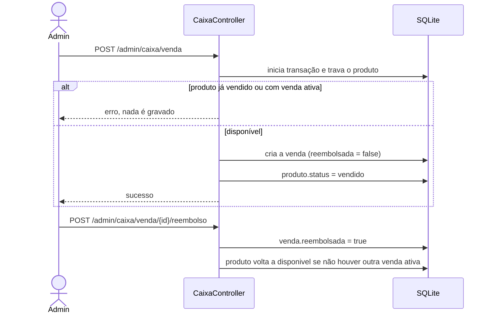

# SlackNovo

Sistema web de gestão de loja de roupas e calçados (brechó). Reúne um catálogo público de produtos e um painel administrativo com cadastro de produtos, controle de caixa (vendas, reembolsos e saídas), consignação e relatório de vendas em PDF.

## Tecnologias

| Camada | Tecnologia |
|---|---|
| Linguagem | PHP 8.2+ |
| Framework | Laravel 12 |
| Banco de dados | SQLite (`database/database.sqlite`) |
| Views | Blade |
| Estilo | Bootstrap 5.3.3 e Bootstrap Icons 1.11.3 (CDN jsDelivr) |
| Build front-end | Vite 7, Tailwind CSS 4 e axios |
| Testes | PHPUnit 11 |
| Padronização de código | Laravel Pint |

## Arquitetura

Monólito Laravel (MVC), sem API REST separada e sem SPA. O servidor renderiza as páginas em Blade.



### Estrutura de pastas

| Pasta | Conteúdo |
|---|---|
| `app/Http/Controllers/` | `CatalogController` (público) e `AuthController` (login e logout) |
| `app/Http/Controllers/Admin/` | `DashboardController`, `ProdutoController`, `CaixaController`, `RelatorioController` e CRUDs de categorias, cores, materiais e fornecedores |
| `app/Models/` | `Produto`, `Venda`, `SaidaCaixa`, `Categoria`, `Cor`, `Material`, `Fornecedor`, `User` |
| `routes/web.php` | Todas as rotas da aplicação |
| `resources/views/` | Telas Blade: `catalog/`, `auth/`, `admin/*`, `layouts/`, `components/`, `partials/` |
| `database/migrations/` | Esquema do banco |
| `tests/Feature/` | Testes dos fluxos críticos |

## Módulos e rotas

| Módulo | Rotas | Acesso |
|---|---|---|
| Catálogo público | `GET /` (filtros `q`, `categoria`, `tamanho`, `ordenar`) | Público |
| Autenticação | `GET/POST /login`, `POST /logout` | Visitante / logado |
| Dashboard | `GET /dashboard` | Logado |
| Produtos | `/admin/produtos` (CRUD, sem tela de detalhe) | Logado |
| Cadastros de apoio | `/admin/categorias`, `/admin/cores`, `/admin/materiais`, `/admin/fornecedores` | Logado |
| Caixa | `GET /admin/caixa`, `POST /admin/caixa/saida`, `POST /admin/caixa/venda`, `POST /admin/caixa/venda/{venda}/reembolso` | Logado |
| Relatórios | `GET /admin/relatorios/produtos` (JSON), `GET /admin/relatorios/exportar` (PDF, filtros `inicio` e `fim`) | Logado |
| Saúde | `GET /up` | Público |

## Banco de dados

| Tabela | Papel |
|---|---|
| `produtos` | Peças à venda: estado (`novo`, `usado`, `consignado`), `status` (`disponivel`, `vendido`), preços, imagem e dados de consignação |
| `vendas` | Vendas e reembolsos (`reembolsada`), um produto por venda |
| `saida_caixas` | Saídas de dinheiro, incluindo pagamento de consignados |
| `categorias`, `cores`, `materiais`, `fornecedores` | Tabelas de apoio dos produtos |
| `usuarios` | Contas de acesso ao painel (`nome` e `senha`) |

O framework também usa as tabelas `sessions`, `cache`, `cache_locks`, `jobs`, `job_batches`, `failed_jobs`, `password_reset_tokens` e `migrations`.

## Autenticação e autorização

- Guard `web`, com sessão armazenada no banco (duração de 120 minutos por padrão).
- Provider Eloquent com o model `App\Models\User`, ligado à tabela `usuarios`.
- Login por nome de usuário e senha. A senha é guardada com hash na coluna `senha` e a sessão é regenerada no login.
- Há dois níveis de acesso: visitante (catálogo e login) e usuário autenticado, que acessa todo o painel. Não existem perfis, permissões, cadastro público nem recuperação de senha.
- Os formulários usam a proteção CSRF padrão do Laravel.

## Armazenamento de arquivos

- A imagem do produto (`imagen`) é validada como imagem de até 5 MB e salva no disco `public`, em `storage/app/public/produtos`.
- As páginas exibem as imagens por `asset('storage/...')`, então é necessário criar o link simbólico: `php artisan storage:link`.
- Ao substituir a imagem ou excluir o produto, o arquivo anterior não é apagado do disco.

## Integrações e serviços

- **E-mail:** o sistema não envia e-mails (`MAIL_MAILER=log`).
- **Filas:** o driver é `database`, mas nenhuma tarefa é enviada para a fila atualmente.
- **CDN:** Bootstrap e Bootstrap Icons são carregados do jsDelivr. Sem internet, a interface perde o estilo.
- **WhatsApp:** o catálogo tem um link de contato `wa.me`, com o número definido diretamente na view `catalog/dashboard.blade.php`.
- **PDF:** o relatório de vendas é gerado no próprio `RelatorioController` (uma página, fonte Helvetica). Listas muito longas não são paginadas.
- **APIs:** não há API pública nem autenticação por token. `GET /admin/relatorios/produtos` devolve JSON dos produtos apenas para usuários logados.

## Fluxos principais

### Venda e reembolso



O saldo do caixa é a soma das vendas não reembolsadas menos a soma das saídas. Saídas manuais exigem valor mínimo de 0,01 e motivo de até 50 caracteres.

### Consignação

Um produto com estado `consignado` guarda o nome do cliente e a marcação de pagamento (`consignado_pago`). Ao salvar com o pagamento marcado, o sistema registra uma única saída no caixa com o motivo `Pagamento consignado produto #ID`. Se o registro da saída falhar, a gravação do produto é desfeita.

### Catálogo público

`GET /` lista apenas produtos disponíveis, com busca por nome, descrição ou código, filtros por categoria e tamanho e ordenação por preço ou nome.

### Dashboard e relatório

O dashboard mostra indicadores de vendas e saídas e a lista de produtos com filtros. O relatório em PDF lista as vendas do período informado.

## Como executar

Requisitos: PHP 8.2+, Composer, Node.js e npm.

```bash
composer run setup         # dependências, .env, chave, migrations e build do front-end
php artisan storage:link   # exibição das imagens dos produtos
composer run dev           # servidor, fila, logs e Vite
composer run test          # testes automatizados
```

Use o `.env.example` como base para o `.env`. O arquivo `.env` não deve ser versionado, e chaves, senhas e tokens ficam apenas no ambiente de cada pessoa ou servidor.

Principais variáveis: `APP_*`, `DB_CONNECTION`, `SESSION_DRIVER`, `QUEUE_CONNECTION`, `CACHE_STORE`, `FILESYSTEM_DISK` e `MAIL_*`.

## Testes

Os testes ficam em `tests/Feature/CriticalFlowsTest.php` e rodam em SQLite em memória. Cobrem o rehash de senha no login, o CRUD de categorias, a venda de produto já vendido, a venda duplicada, o reembolso (incluindo repetição e outra venda ativa) e a consignação (pagamento único e desfazer em caso de falha).

## Contribuição

- Trabalhe em uma branch própria a partir de `develop` e abra um Pull Request. Não faça commits diretamente na `main`.
- Mudanças em migrations, seeds ou consultas também seguem esse fluxo.
- Não registre secrets, tokens, senhas ou dados reais em código, commits, PRs, logs ou capturas de tela.

## Limitações conhecidas

- O banco não tem chaves estrangeiras nem índices nas tabelas de negócio.
- Todo usuário autenticado tem acesso total ao painel.
- Não há tela ou seeder para criar o primeiro usuário; ele precisa ser inserido diretamente no banco.
- Os arquivos `resources/css/style.css`, `resources/css/login.css`, `resources/js/script.js` e `resources/js/scripts.js` não são carregados por nenhuma view.
- A dependência `barryvdh/laravel-dompdf` está instalada, mas o PDF é gerado manualmente.
- Não há pipeline de integração contínua configurado.