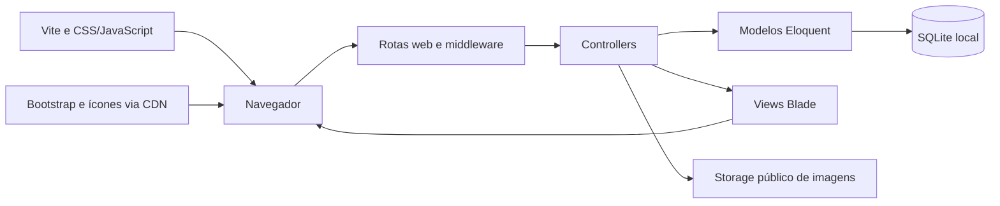

# SLK-02 — Levantamento técnico do sistema atual

## Resultado e escopo

Levantamento concluído no checkout local em 08/11/2026, com base no código, nas dependências fixadas e nas verificações descritas abaixo. Base Git inspecionada: `90d0373`. Este documento libera a revisão técnica SLK-03; não comprova implantação ou acesso ao ambiente de produção. Nenhum código de aplicação ou credencial foi alterado e nenhum commit foi realizado.

Não foram encontrados arquivos `AGENTS.md` dentro do projeto. O documento anterior `docs/checklist-assuncao.md` complementa o inventário inicial.

## Arquitetura

Aplicação monolítica Laravel com interface renderizada no servidor por Blade. O navegador envia requisições às rotas web; middleware de sessão, autenticação e proteção CSRF do grupo web precedem os controllers. Os controllers concentram consultas, validações e regras de negócio, usando modelos Eloquent e transações no banco. Não há API separada, SPA, camada de serviços de domínio ou frontend framework identificados no código próprio inspecionado.



Evidências principais: `bootstrap/app.php`, `routes/web.php`, `app/Http/Controllers/`, `app/Models/`, `resources/views/` e `vite.config.js`.

## Stack e ferramentas

| Componente | Versão / característica | Fonte |
| --- | --- | --- |
| PHP | Requisito ^8.2; instalado 8.4.1 | `composer.json`, `php -v` |
| Laravel | 12.69.3 | `composer.lock` |
| Composer | Local 2.8.3 | `composer --version` |
| Node.js / npm | Locais 26.13.0 / 12.2.1 | comandos de versão |
| Banco | SQLite ativo localmente; Eloquent | configuração efetiva do Laravel |
| Templates | Blade | `resources/views/` |
| Vite | 7.3.6 | `package-lock.json` |
| Tailwind CSS | 4.2.4 | `package-lock.json` |
| Bootstrap / Bootstrap Icons | 5.3.3 / 1.11.3 por jsDelivr | `resources/views/layouts/app.blade.php` |
| Axios | 1.20.0 | `package-lock.json` |
| concurrently | 9.2.4 | `package-lock.json` |
| laravel-dompdf / Dompdf | 3.1.2 / 3.1.6 instalados | `composer.lock` |
| PHPUnit / Pint | 11.5.55 / 1.29.1 | `composer.lock` |

A dependência Dompdf está instalada, mas o exportador atual constrói um PDF manualmente em `RelatorioController::gerarPdfSimples`; não foi identificado uso dela nesse fluxo.

## Módulos e endpoints

| Módulo | Comportamento observado | Entradas principais |
| --- | --- | --- |
| Catálogo público | Produtos disponíveis, pesquisa, filtros e ordenação; paginação de 24 itens | `GET /` |
| Autenticação | Nome e senha, limitação por conta e IP, rotação de sessão, logout | `GET/POST /login`, `POST /logout` |
| Dashboard | Indicadores de vendas dos últimos seis meses, saldo e listagem de produtos com filtros | `GET /dashboard` |
| Produtos | Criar, listar, editar e excluir; upload de imagem; consignação | `/admin/produtos` |
| Cadastros auxiliares | Listar, criar, atualizar e excluir categorias, cores, materiais e fornecedores | `/admin/categorias`, `/admin/cores`, `/admin/materiais`, `/admin/fornecedores` |
| Caixa | Registrar venda, registrar saída, reembolsar venda e consultar movimentos | `/admin/caixa` e ações POST subordinadas |
| Relatórios | Produtos em JSON e vendas em PDF com filtro de datas | `/admin/relatorios/produtos`, `/admin/relatorios/exportar` |

`php artisan route:list --except-vendor --json` confirmou 33 registros de rotas da aplicação. A rota de saúde `/up` está configurada no bootstrap. Todas as rotas privadas declaradas em `routes/web.php` usam `auth` e `auth.session`. Não há papéis/permissões distintos ou cadastro público identificados: qualquer usuário autenticado acessa esses módulos.

## Fluxos principais

1. **Acesso:** `AuthController` valida `nome` e `password`, autentica pelo modelo configurado e redireciona ao dashboard. `config/auth.php` aponta por padrão para `App\Models\User`; esse modelo usa a tabela `usuarios` e a coluna de hash `senha`. `App\Models\Usuario` oferece implementação semelhante. Mudança de senha invalida sessões por `auth.session`. A tabela local `usuarios` contém zero registros; não existe acesso inicial provisionado pelo seeder.
2. **Produto e imagem:** `ProdutoRequest` valida campos, limites monetários, enumerações, vínculos e imagem de até 5 MiB. `ProdutoController` grava o produto em transação, guarda imagens em `storage/app/public/produtos`, remove uploads em falhas/rollback e agenda limpeza da imagem antiga após commit. Os vínculos são categoria, cor, material e fornecedor.
3. **Consignação:** ao salvar produto consignado marcado como pago, o controller registra uma saída pelo preço de compra caso não encontre uma saída com o motivo correspondente ao ID do produto.
4. **Venda:** `CaixaController::registrarVenda` valida os dados, abre transação, solicita bloqueio do produto, verifica venda ativa/status, registra o histórico de valores e altera status para vendido.
5. **Reembolso:** bloqueia produto e venda em transação, marca a venda como reembolsada e só disponibiliza o produto se não restar outra venda ativa. Repetição retorna mensagem de erro sem novo reembolso.
6. **Relatórios:** consulta produtos por filtros e retorna JSON; consulta vendas por datas e constrói PDF simples. O comportamento e a qualidade dos relatórios devem ser aprofundados na SLK-03.

Evidências: `AuthController.php`, `ProdutoController.php`, `CaixaController.php`, `RelatorioController.php`, `ProdutoRequest.php`, `MoneyRules.php` e modelos associados.

## Dados, configuração e integrações

- Configuração efetiva local confirmada via bootstrap do Laravel: banco SQLite, cache/sessões/filas em `database`, mailer `log` e filesystem padrão `local`.
- As 21 migrações estão aplicadas no banco local, conforme `php artisan migrate:status`. Há tabelas de infraestrutura do Laravel e tabelas de domínio para usuários, clientes, fornecedores, materiais, categorias, cores, produtos, vendas e saídas. A análise detalhada de esquema e integridade pertence à SLK-04.
- O disco `public` fornece imagens por `public/storage`; `php artisan storage:link` é necessário em ambientes novos. Configuração S3 existente no arquivo padrão não comprova uso de S3.
- Bootstrap e ícones dependem de CDN no navegador. O catálogo contém link de WhatsApp com número fixo de exemplo (`resources/views/catalog/dashboard.blade.php`). Não há integração de pagamentos ou API de WhatsApp identificada.
- Configurações padrão de serviços, Redis e e-mail não constituem evidência de integração ativa. Nenhuma credencial foi incluída neste documento.
- Não foram encontrados configuração de deploy, pipeline em `.github`, domínio de produção ou documentação de provedor de hospedagem no checkout inspecionado.

## Execução local

As dependências já foram instaladas na etapa anterior. Os arquivos de lock devem ser usados para reproduzir versões:

```bash
composer install
npm ci
```

Em uma instalação nova, criar `.env` a partir de `.env.example` apenas se ele ainda não existir, criar o arquivo SQLite se ausente e gerar a chave apenas na configuração inicial. Em seguida:

```bash
php artisan migrate
php artisan storage:link
npm run build
composer run dev
```

`composer run dev` inicia Artisan serve, escuta de fila, Pail e Vite com concurrently. Endereço de desenvolvimento usual: `http://127.0.0.1:8000`; Vite usa porta 5173. O script `setup` existe em `composer.json`, mas inclui `key:generate`: não deve ser tratado como comando de manutenção de uma instalação existente com sessões/dados criptografados.

## Testes e validação realizada

| Verificação | Resultado |
| --- | --- |
| `php artisan route:list --except-vendor --json` | 33 registros; middleware e ações confirmados |
| `php artisan migrate:status --no-ansi` | 21 migrações aplicadas |
| Bootstrap e leitura de configuração efetiva | SQLite e drivers locais confirmados; zero usuários |
| `php artisan test --no-ansi` | **60 testes aprovados, 1135 asserções, 15,83 segundos** |

A suíte usa SQLite `:memory:`, cache/sessão em array e fila síncrona, conforme `phpunit.xml`. Os testes de integridade controlam diretamente migrações/reconstruções; outros testes de feature usam RefreshDatabase. O resultado não valida comportamento em MySQL/PostgreSQL nem concorrência real em produção.

Cobertura funcional existente por arquivos:

- `AuthenticationSecurityTest`: limites de login, erros genéricos, tipos inválidos, bloqueio de anônimos, CSRF, rotação de sessão, logout e revogação por mudança de senha.
- `CriticalFlowsTest`: rehash da senha, categorias, venda duplicada, reembolso, revenda e consignação com rollback.
- `ProductSecurityTest`: valores e relações inválidas, dinheiro, imagens e limpeza após transação.
- `ProductIntegrityMigrationTest`: referências, exclusão de pais, upgrade/rollback de SQLite e preservação de dados/objetos.
- `ExampleTest` de feature: resposta inicial; teste unitário padrão: asserção básica.

Não foi produzida medição de cobertura por linhas, auditoria de dependências ou teste de navegador nesta atividade. O build concluído na instalação anterior é evidência da etapa de inicialização, não um novo teste deste levantamento.

## Lacunas e encaminhamento

1. Falta procedimento de provisionamento do primeiro usuário e documentação funcional de administração; banco local sem usuários.
2. Falta documentação de implantação, infraestrutura, operação, backup/restauração e ambiente de produção acessível para validação.
3. README é majoritariamente padrão do Laravel, com instruções locais e correções de cache; este levantamento complementa a documentação específica.
4. Ausência de perfis distintos é comportamento atual; confirmar necessidade de autorização por papel com o negócio antes de classificar como defeito.
5. Controllers concentram regras de negócio, consultas e compatibilidade dinâmica de esquema. A SLK-03 deve avaliar manutenção, consistência financeira, relatórios, desempenho e cenários não exercitados pela suíte.
6. A SLK-04 deve verificar chaves, índices, exclusões, migrações legadas e concorrência usando o levantamento e os achados da SLK-03.

Critério de conclusão desta atividade: arquitetura, stack, módulos, fluxos, integrações e testes inventariados com evidência local. **Atendido.** A aprovação funcional do negócio e a situação de produção permanecem fora do que foi comprovado.
