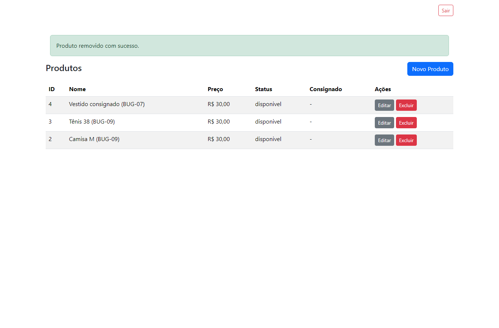
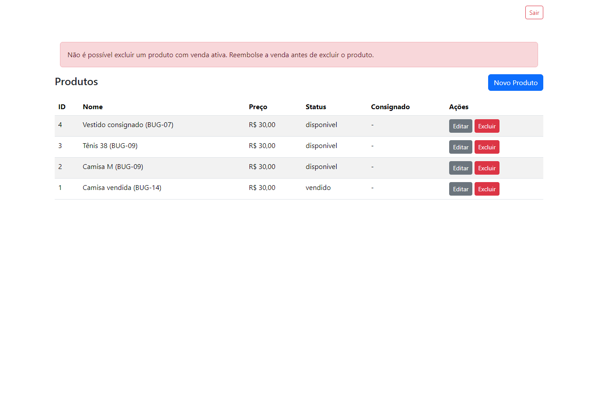
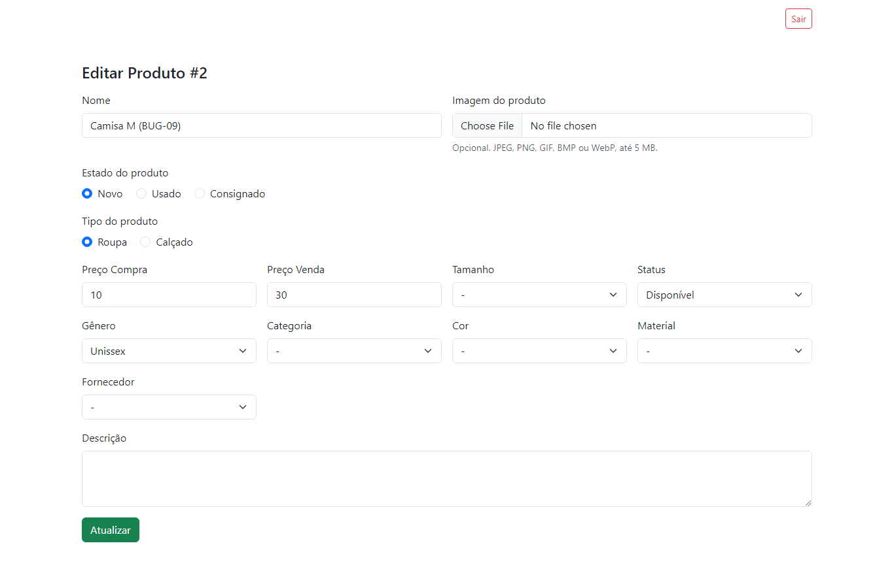
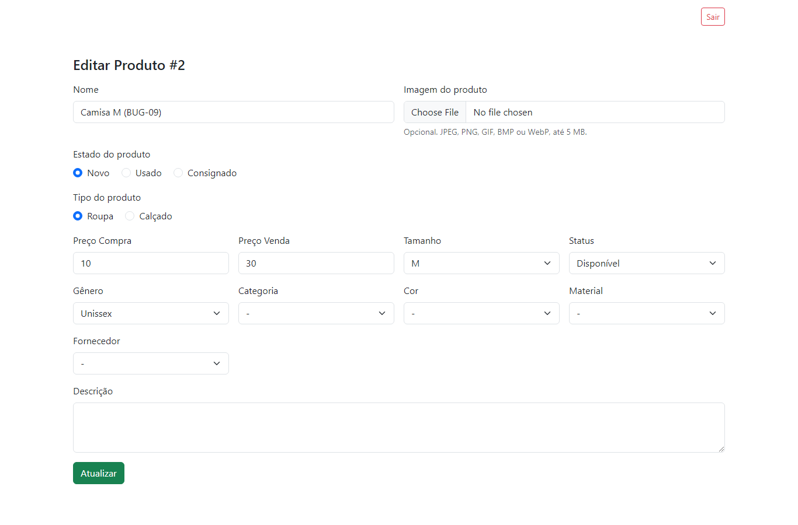
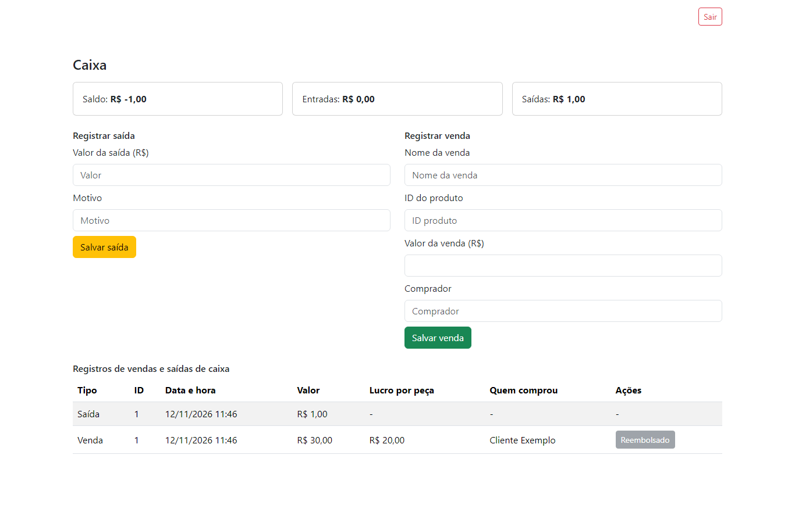
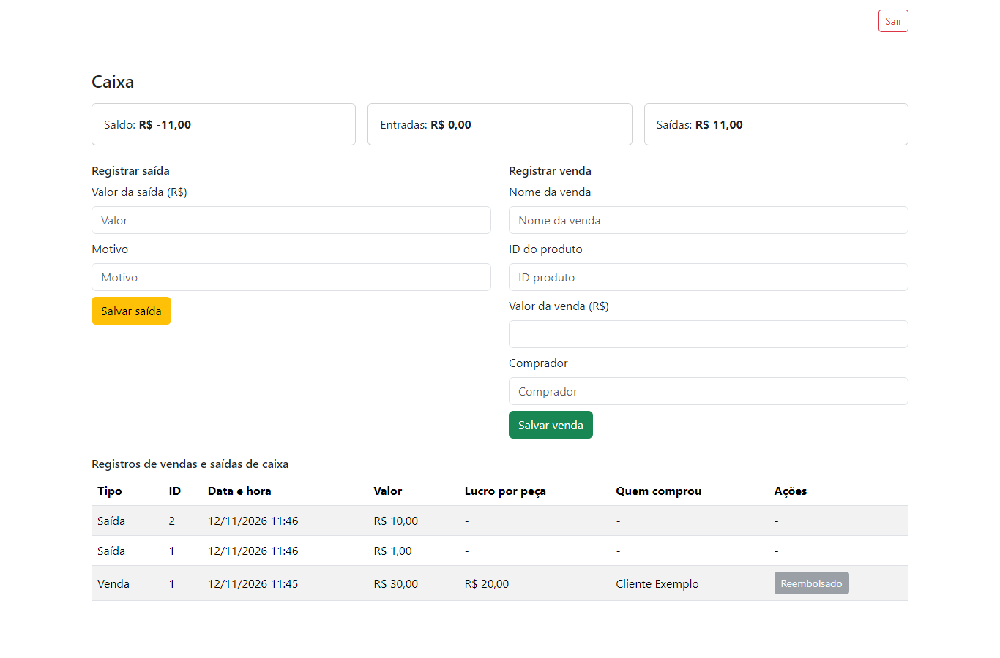

# SLK-07 — Relatório de validação: correção de bugs críticos e de integridade de dados

Data: 12/11/2026 · Base: `main` @ `bbaddcc` · Task de origem: **SLK-07** (correção de bugs) · Status: **correções concluídas e validadas localmente; branches não publicadas e PRs não abertos (aguardando autorização)**

## 1. Resumo

| Item | Resultado |
| --- | --- |
| Bugs **Críticos** abertos | Nenhum encontrado (auditoria de 19/10, SLK-03, SLK-05 e revisão de 12/11) |
| Bugs **Altos** (BUG-01 a BUG-05) | **Corrigidos na `main`** pelo commit [`0548ce1`](https://github.com/isabellaruthes/SlackNovo/commit/0548ce1e6b46c530ce8bb0999f03396c017fe1d5), com testes de regressão que passam (seção 3) |
| Bugs de integridade de dados aprovados nesta etapa | **BUG-07, BUG-09, BUG-14 corrigidos**, um por branch, com teste de regressão que falha antes e passa depois |
| Suíte na `main` (linha de base) | SQLite `OK (81 tests, 1400 assertions)` · MySQL 8.4 `OK (69 tests, 645 assertions)` |
| Suíte com as três correções integradas | SQLite `OK (96 tests, 1461 assertions)` · MySQL 8.4 `OK (84 tests, 706 assertions)` · nenhuma regressão |
| Navegador (Chromium headless, com e sem JavaScript) | Defeitos reproduzidos na `main` e ausentes com as correções (seção 5.3) |
| Estilo (Pint) nos arquivos alterados | Aprovado nas três branches |
| Fora do escopo por decisão | BUG-10 (reconstrução da tabela `produtos` no SQLite, maior risco) |
| Achado novo | **BUG-19** (BAIXA): rollback da migration `2026_08_28` falha com produto sem imagem |

## 2. Origem e critérios

- **Tasks e documentos de origem:** [SLK-03 — revisão de código](SLK-03-review-codigo.md), [SLK-05 — revisão de segurança](SLK-05-revisao-seguranca.md), [SLK-07 — correções anteriores (REV-01 a REV-06)](SLK-07-correcao-bugs.md) e a auditoria de bugs de 19/10/2026 (BUG-01 a BUG-18), registrada na branch local `docs/plano-correcao-bugs` (não publicada).
- **Prioridades da task:** (1) erros que impedem funcionalidades; (2) falhas de segurança, perda de dados e erros de banco; (3) falhas de autenticação, autorização e integrações.
- **Escopo aprovado pelo responsável em 12/11/2026:** corrigir os bugs que ficaram abertos e fora da `main` (BUG-07, BUG-09, BUG-14), deixando o BUG-10 para depois, e não abrir PR por enquanto.
- **Regra respeitada:** nenhuma alteração direta na `main`. Cada correção está em uma branch `fix/slk-07-*` própria, criada a partir da `main` @ `bbaddcc`.

## 3. Bugs de criticidade Alta (BUG-01 a BUG-05): situação

Esses bugs foram encontrados na auditoria de 19/10. Na época, as correções ficaram em branches locais (`fix/exibe-mensagens-feedback`, `fix/caixa-form-venda-valor`, `fix/form-produto-preserva-genero`, `fix/relatorio-vendas-*`), que nunca foram publicadas. Em 08/11, o commit `0548ce1` (isabellaruthes) incorporou correções equivalentes **direto na `main`, sem PR**. As branches antigas ficaram obsoletas e não serão publicadas.

| Achado | Correção na `main` | Verificação em 12/11 |
| --- | --- | --- |
| BUG-01 Mensagens do painel nunca exibidas | `layouts/app.blade.php` inclui `partials.alerts`, que trata `success`, `error` e erros de validação | Teste original `FeedbackMessagesTest`: `OK (4 tests)`; `FunctionalAcceptanceTest` |
| BUG-02 Venda pela tela Caixa sempre rejeitada | Campo `valor_venda` no formulário do caixa | Teste original `CaixaSaleFormTest`: `OK (1 test)`; `FunctionalAcceptanceTest` |
| BUG-03 Editar produto apagava o gênero | `@selected` no select de gênero | Teste original `ProductFormGeneroTest`: `OK (2 tests)`; `FunctionalAcceptanceTest` |
| BUG-04 PDF somava reembolsadas como receita | PDF Dompdf com coluna "Situação" (Ativa/Reembolsada) e sem total que infle a receita | `ReviewRegressionTest` (REV-03) |
| BUG-05 PDF truncava após ~56 vendas | Dompdf com paginação real | `ReviewRegressionTest` (REV-01): 100 vendas, 3 páginas |

Evidência: [`testes/bug01-02-03-verificacao-main.txt`](evidencias/SLK-07/testes/bug01-02-03-verificacao-main.txt).

**Desvio registrado:** a regra "implementar cada correção em branch específica e abrir Pull Request" não foi seguida para BUG-01 a BUG-05, porque as correções entraram por commit direto na `main`. Isso não pode ser refeito retroativamente sem duplicar código. A rastreabilidade fica neste relatório (achado → commit `0548ce1` → teste).

## 4. Correções desta etapa

### 4.1 BUG-14 — Produto com venda ativa podia ser excluído

| Campo | Registro |
| --- | --- |
| Severidade | BAIXA na auditoria de 19/10; tratado agora como integridade de dados (prioridade 2 da task), por aprovação do responsável |
| Causa | `ProdutoController::destroy` apagava o produto sem verificar vendas, e `vendas.id_produto` não tem chave estrangeira |
| Impacto | A venda ativa ficava órfã: o histórico perdia o vínculo com a peça vendida e o produto sumia do estoque |
| Solução | Antes de apagar, a exclusão verifica, sob o mesmo `lockForUpdate` do produto usado por venda e reembolso, se existe venda não reembolsada. Se existir, nada é apagado e o operador vê: "Não é possível excluir um produto com venda ativa. Reembolse a venda antes de excluir o produto." Produtos sem vendas, ou só com vendas reembolsadas, continuam podendo ser excluídos. |
| Arquivo | `app/Http/Controllers/Admin/ProdutoController.php` |
| Teste de regressão | `tests/Feature/ProductDeletionWithActiveSaleTest.php` (3 testes) |
| Antes / depois | Antes: 1 falha (o produto foi excluído). Depois: `OK (3 tests, 12 assertions)` |
| Branch / commit | `fix/slk-07-produto-venda-ativa-exclusao` / `f37c2626620ed1f13b8676217e3252ddf1b0ca27` |
| PR | Não aberto (aguardando autorização) |

| Antes (`main`) | Depois |
| --- | --- |
|  "Produto removido com sucesso." e a venda fica órfã |  Exclusão bloqueada com orientação |

Depois do reembolso, a exclusão funciona: [print](evidencias/SLK-07/navegador/depois/bug14-2-exclusao-apos-reembolso.png).

### 4.2 BUG-09 — Tamanho do produto apagado quando o JavaScript não roda

| Campo | Registro |
| --- | --- |
| Severidade | MÉDIA (perda de dado) |
| Causa | O formulário tem dois `<select name="tamanho">`, um para roupa e outro para calçado, e o inativo só era desabilitado por JavaScript. Sem JS (bloqueado, com erro de script ou CDN indisponível), o navegador enviava os dois selects, e o de calçado, vazio, chegava por último. |
| Impacto | Salvar uma roupa apagava o tamanho dela, sem nenhum aviso |
| Solução | (1) O servidor já renderiza o select inativo com `disabled` e `d-none` conforme o tipo atual, inclusive após erro de validação; o JS continua alternando os selects ao trocar o tipo. (2) `ProdutoRequest` valida o tamanho contra a lista do tipo enviado, então roupa não aceita numeração e calçado não aceita letra. (3) O formulário e a validação usam as mesmas constantes de tamanho. |
| Arquivos | `resources/views/admin/produtos/_form.blade.php`, `app/Http/Requests/ProdutoRequest.php` |
| Teste de regressão | `tests/Feature/ProductFormTamanhoWithoutJavaScriptTest.php` (6 testes). Serializa o formulário renderizado como um navegador sem JS e o reenvia. |
| Antes / depois | Antes: 4 falhas (`'m'` → `''`, select de calçado habilitado, tamanhos incompatíveis aceitos). Depois: `OK (6 tests, 24 assertions)` |
| Branch / commit | `fix/slk-07-form-produto-tamanho-sem-js` / `f5da3b3e5b400be4c965892405d7240d8fb90a9d` |
| PR | Não aberto (aguardando autorização) |

| Antes (`main`), sem JS: tamanho apagado | Depois, sem JS: tamanho preservado |
| --- | --- |
|  |  |

Regressão com JS ativo (trocar roupa por calçado tamanho 40): funciona antes e depois. Veja o [print](evidencias/SLK-07/navegador/depois/bug09-com-js-troca-para-calcado.png).

### 4.3 BUG-07 — Saída manual suprimia o pagamento ao consignante

| Campo | Registro |
| --- | --- |
| Severidade | MÉDIA (dado financeiro incorreto no caixa) |
| Causa | A idempotência do pagamento de consignado usava o texto livre `saida_caixas.motivo` ("Pagamento consignado produto #N"). Qualquer saída com esse texto, inclusive manual, fazia o sistema considerar o pagamento já feito. |
| Impacto | O valor devido à consignante nunca entrava nas saídas; o saldo do caixa ficava maior que o real |
| Solução | Migration `2026_11_12_000000_add_id_produto_consignado_to_saida_caixas_table` (detalhada abaixo); `ProdutoController` verifica e grava esse vínculo, e não mais o texto. A coluna não é atribuível em massa, então o formulário de saída manual não consegue vinculá-la. |
| Migration | Adiciona `saida_caixas.id_produto_consignado`: nullable, com **índice único**, sem FK, para preservar o histórico se o produto for excluído. Também vincula os pagamentos já gravados: para cada produto, a saída mais antiga com o texto automático exato, para que nenhum produto já pago seja pago de novo após o deploy. |
| Arquivos | `database/migrations/2026_11_12_000000_add_id_produto_consignado_to_saida_caixas_table.php`, `app/Http/Controllers/Admin/ProdutoController.php` |
| Testes de regressão | `tests/Feature/ConsignmentPaymentIdempotencyTest.php` (4) e `tests/Feature/ConsignmentPaymentMigrationTest.php` (2: vínculo dos dados legados e ausência de pagamento em dobro após o deploy) |
| Antes / depois | Antes: 2 falhas e 3 erros (saída manual suprime o pagamento; pagamento não vinculado; a coluna e a migration não existem). Depois, com `--filter Consignment`: `OK (9 tests, 45 assertions)` (6 novos e 3 de consignação já existentes), e as suítes completas passam em SQLite e MySQL |
| Branch / commit | `fix/slk-07-consignado-pagamento-idempotente` / `b54effd28c8170a19b8cec7968ec7d26311345d6` |
| PR | Não aberto (aguardando autorização) |

| Antes (`main`): saídas = R$ 1,00 (pagamento de R$ 10,00 perdido) | Depois: saídas = R$ 11,00 |
| --- | --- |
|  |  |

**Migration validada em banco real:**
- SQLite em arquivo: migrate → rollback → migrate. Veja o [log](evidencias/SLK-07/banco/bug07-migration-sqlite.txt).
- MySQL 8.4.9 com dados legados simulados: o pagamento repetido e a saída "parcial" ficaram sem vínculo, e só o primeiro pagamento foi vinculado; depois, rollback e migrate de novo. Veja o [log](evidencias/SLK-07/banco/bug07-migration-mysql.txt).

**Limite e regra de negócio pendente:** quando o custo muda depois do pagamento, a saída não é ajustada. Isso exige uma decisão de negócio e continua no backlog. Saídas legadas digitadas manualmente com o texto exato do pagamento automático não podem ser distinguidas do pagamento real. A migration vincula só a mais antiga, o que preserva o comportamento atual (um pagamento por produto).

## 5. Validação

### 5.1 Suíte automatizada (PHPUnit)

| Execução | SQLite `:memory:` | MySQL 8.4.9 (\*) |
| --- | --- | --- |
| `main` @ `bbaddcc` (linha de base) | `OK (81 tests, 1400 assertions)` | `OK (69 tests, 645 assertions)` |
| `fix/slk-07-produto-venda-ativa-exclusao` | `OK (84 tests, 1412 assertions)` | `OK (72 tests, 657 assertions)` |
| `fix/slk-07-form-produto-tamanho-sem-js` | `OK (87 tests, 1424 assertions)` | `OK (75 tests, 669 assertions)` |
| `fix/slk-07-consignado-pagamento-idempotente` | `OK (87 tests, 1425 assertions)` | `OK (75 tests, 670 assertions)` |
| Integração: merge temporário das 3 branches sobre a `main` (sem conflitos; branch descartada) | `OK (96 tests, 1461 assertions)` | `OK (84 tests, 706 assertions)` |

(\*) No MySQL, o `AuthenticationSecurityTest` (12 testes) é excluído porque o próprio teste exige SQLite `:memory:` e lança `LogicException` em outro banco. O comportamento é igual na `main`.

Os logs estão em [`evidencias/SLK-07/testes/`](evidencias/SLK-07/testes/): `*-antes.txt` e `*-depois.txt` para cada bug, `*-suite*.txt` para cada branch, `main-*` para a linha de base e `integracao-*` para a integração.

### 5.2 Estilo

`vendor/bin/pint --test` nos arquivos alterados: `passed` nas três branches. Veja `testes/bug*-pint.txt`.

### 5.3 Navegador

Roteiro reproduzível: [`scripts/slk07-browser.cjs`](evidencias/SLK-07/scripts/slk07-browser.cjs) com [`scripts/fixture-slk07.php`](evidencias/SLK-07/scripts/fixture-slk07.php).
- Ambiente: Chromium headless (Playwright 1.49.1, ferramenta externa e fora das dependências do projeto) e servidor embutido do PHP.
- Dados: banco SQLite temporário e senha aleatória por execução. O banco local da aplicação não foi usado.
- O mesmo roteiro rodou na `main` (antes) e na integração (depois).

| Cenário | Antes (`main`) | Depois |
| --- | --- | --- |
| BUG-14: excluir produto com venda ativa | Excluído: "Produto removido com sucesso." | Bloqueado com orientação; o produto continua na lista |
| BUG-14: excluir após reembolso | — | Excluído com sucesso |
| BUG-09: salvar roupa (tamanho M) sem JS | Tamanho após salvar: vazio | Tamanho após salvar: `m` |
| BUG-09: salvar calçado (38) sem JS | `38` | `38` |
| BUG-09: com JS, trocar roupa → calçado 40 | `calcado` / `40` | `calcado` / `40` (sem regressão) |
| BUG-07: saída manual de R$ 1,00 com o texto do pagamento, depois marcar consignado pago (custo R$ 10,00) | Saídas: R$ 1,00 (1 linha) | Saídas: R$ 11,00 (2 linhas) |

Resultados brutos: [`resultados-antes.json`](evidencias/SLK-07/navegador/resultados-antes.json) e [`resultados-depois.json`](evidencias/SLK-07/navegador/resultados-depois.json). Os prints usam apenas dados fictícios da fixture.

## 6. Rastreabilidade

| Achado | Sev. | Branch | Commit | Teste de regressão | PR |
| --- | --- | --- | --- | --- | --- |
| BUG-01 | ALTA | — (commit direto na `main`) | [`0548ce1`](https://github.com/isabellaruthes/SlackNovo/commit/0548ce1e6b46c530ce8bb0999f03396c017fe1d5) | `FunctionalAcceptanceTest` | Não houve |
| BUG-02 | ALTA | — (commit direto na `main`) | `0548ce1` | `FunctionalAcceptanceTest` | Não houve |
| BUG-03 | ALTA | — (commit direto na `main`) | `0548ce1` | `FunctionalAcceptanceTest` | Não houve |
| BUG-04 | ALTA | — (commit direto na `main`) | `0548ce1` | `ReviewRegressionTest` | Não houve |
| BUG-05 | ALTA | — (commit direto na `main`) | `0548ce1` | `ReviewRegressionTest` | Não houve |
| BUG-14 | BAIXA → integridade | `fix/slk-07-produto-venda-ativa-exclusao` (local) | `f37c262` | `ProductDeletionWithActiveSaleTest` | Pendente de autorização |
| BUG-09 | MÉDIA | `fix/slk-07-form-produto-tamanho-sem-js` (local) | `f5da3b3` | `ProductFormTamanhoWithoutJavaScriptTest` | Pendente de autorização |
| BUG-07 | MÉDIA | `fix/slk-07-consignado-pagamento-idempotente` (local) | `b54effd` | `ConsignmentPaymentIdempotencyTest`, `ConsignmentPaymentMigrationTest` | Pendente de autorização |

Depois da publicação autorizada, preencher aqui as URLs das branches (`https://github.com/isabellaruthes/SlackNovo/tree/<branch>`), dos commits e dos PRs.

## 7. Backlog atualizado

| ID | Sev. | Situação em 12/11/2026 | Observação |
| --- | --- | --- | --- |
| BUG-01 a BUG-05 | ALTA | **Corrigidos** (`0548ce1`) | Seção 3 |
| BUG-06 Acentuação no PDF | MÉDIA | **Corrigido** (`0548ce1`, REV-02) | Fonte DejaVu Sans |
| BUG-07 Pagamento de consignado | MÉDIA | **Corrigido nesta etapa** (branch local) | Ajuste do pagamento quando o custo muda continua em aberto (decisão de negócio) |
| BUG-08 Dashboard com venda reembolsada / cards duplicados | MÉDIA | **Corrigido** (`0548ce1`, REV-04) | — |
| BUG-09 Tamanho depende de JS | MÉDIA | **Corrigido nesta etapa** (branch local) | — |
| BUG-10 CHECKs perdidos em `produtos` (SQLite) | MÉDIA | **Aberto**, adiado por decisão | Exige reconstruir a tabela; o MySQL não é afetado |
| BUG-11 Caixa e Dashboard sem paginação | BAIXA | Aberto | `CaixaController` e `DashboardController` usam `get()` |
| BUG-12 Sem mecanismo para criar o primeiro usuário | BAIXA | Aberto (documentado no README) | — |
| BUG-13 "Lucro por peça" exibido em venda reembolsada | BAIXA | Aberto | Visível no print do caixa do BUG-07 |
| BUG-14 Exclusão de produto com venda ativa | BAIXA | **Corrigido nesta etapa** (branch local) | — |
| BUG-15 Data sem formatação no PDF | BAIXA | **Corrigido** (`0548ce1`, REV-06) | — |
| BUG-16 Mensagens de validação em inglês | BAIXA | Aberto | `APP_LOCALE=en`; não há pasta `lang/` |
| BUG-17 Horários em UTC | BAIXA | Aberto | `config/app.php` usa `timezone => 'UTC'`; o PDF informa o fuso |
| BUG-18 Limite de upload do PHP abaixo de 5 MB | MÉDIA | Aberto (configuração do servidor) | Definir `upload_max_filesize` ≥ 6M e `post_max_size` ≥ 8M no ambiente |
| **BUG-19** Rollback da migration `2026_08_28_000000_make_produto_imagen_nullable` falha com produto sem imagem (novo) | BAIXA | Aberto | `down()` volta `imagen` para NOT NULL e o SQLite rejeita as linhas com `NULL`. Afeta só o rollback, não a operação. [Reprodução](evidencias/SLK-07/banco/bug19-rollback-sqlite.txt) |
| SEC-01 Cabeçalhos de segurança / clickjacking | P2 | Aberto (SLK-05) | — |
| SEC-02 CDN sem SRI | P2 | Aberto (SLK-05) | — |

## 8. Ambiente e como reproduzir

- PHP 8.5.11, Composer, Node 24.20.0, Vite (`npm run build`) e MySQL 8.4.9.
- O `php.ini` local não carrega `pdo_sqlite`. As execuções passam as extensões por linha de comando, sem alterar o arquivo:

```bash
php -d extension=pdo_sqlite -d extension=sqlite3 -d extension=fileinfo -d extension=gd vendor/bin/phpunit
```

- **MySQL:** instância descartável, com diretório de dados temporário e porta 3399, encerrada ao final. Comando:

```bash
DB_CONNECTION=mysql DB_HOST=127.0.0.1 DB_PORT=3399 DB_DATABASE=<banco_de_teste> DB_USERNAME=root \
  php -d extension=pdo_mysql ... vendor/bin/phpunit --exclude-filter AuthenticationSecurityTest
```

- **Navegador:**

```bash
PLAYWRIGHT_MODULE=<caminho>/playwright node docs/evidencias/SLK-07/scripts/slk07-browser.cjs <repo> depois <saida>
```

- **Credenciais:** `APP_KEY` efêmera por execução, nenhum `.env` criado e nenhuma credencial registrada. Os caminhos locais nos logs foram trocados por `<repo>` e `<tmp>`.

## 9. Limitações

- Não houve teste de carga, de concorrência real entre dois operadores, nem verificação em servidor de produção (Nginx/Apache).
- A verificação sem JavaScript cobre o formulário de produto. Outras telas não foram avaliadas nessa condição.
- A migration do BUG-07 foi testada com dados legados simulados, não com uma cópia do banco de produção. Recomenda-se rodá-la antes em uma cópia.

## 10. Próximos passos (dependem de autorização)

1. Publicar `fix/slk-07-produto-venda-ativa-exclusao`, `fix/slk-07-form-produto-tamanho-sem-js`, `fix/slk-07-consignado-pagamento-idempotente` e `docs/slk-07-relatorio-validacao`, e abrir um PR por branch com destino `main`.
2. Preencher na seção 6 as URLs de branches, commits e PRs.
3. Priorizar no backlog: BUG-10 (com plano próprio), BUG-18 (configuração), BUG-13 e a regra de ajuste do pagamento de consignado.
