# SLK-09 — Relatório de validação: melhorias prioritárias de UI/UX

Data: 12/11/2026 · Base: `main` @ `bbaddcc` · Task: **SLK-09** · Status: **melhorias implementadas e validadas localmente; branches não publicadas e PRs não abertos (aguardando autorização)**

## 1. Resumo

| Item | Antes (`main`) | Depois (4 branches integradas) |
| --- | --- | --- |
| Violações axe-core (WCAG 2.1 A/AA), 11 telas × desktop e celular | **63 elementos** (rótulos ausentes, selects sem nome, contraste) | **0** |
| Vazamento horizontal em 390 px | Dashboard: **46 px** | **Nenhuma tela** |
| Primeiro Tab do teclado | Vai para o logotipo | Link **"Pular para o conteúdo"** visível |
| Mensagem de validação | "The valor field format is invalid." | "Informe o valor da saída como um número positivo com até 2 casas decimais (ex.: 10.50)." |
| Campos com erro destacados | 0 | Campo marcado (`is-invalid`, `aria-invalid`) e mensagem ao lado |
| Horários | UTC | Fuso de São Paulo (só na exibição) |
| Dashboard no celular | Todos os produtos em uma página (~8.200 px com 49 itens) | 24 por página, com os filtros preservados |
| Suíte PHPUnit | SQLite `OK (81 tests)` · MySQL `OK (69 tests)` | SQLite `OK (110 tests, 1569 assertions)` · MySQL `OK (98 tests, 814 assertions)` |
| Teste de aceitação de navegador do projeto (`tests/Browser/acceptance.cjs`) | Não rodava no Windows | 4 cenários aprovados, sem erro de página |

**Ponto de partida.** A `main` já tinha UX-01 a UX-07 da [SLK-06](SLK-06-revisao-interface.md), implementados no commit direto `0548ce1` ([SLK-09 anterior](SLK-09-melhorias-interface.md)) e validados na [SLK-10](SLK-10-testes-funcionais.md). Esta etapa tratou o que a auditoria de 12/11/2026 ainda encontrou na `main` e o que faltava na checklist da task.

## 2. Checklist da task

| Item | Situação | Onde |
| --- | --- | --- |
| Responsividade corrigida | ✅ Nenhum vazamento horizontal em 390 px nas 11 telas; dashboard paginado | UI-03 |
| Navegação revisada | ✅ Menu já responsivo (UX-04); contraste do "Sair" corrigido; link para pular ao conteúdo; página ativa com `aria-current` | UI-01 |
| Formulários e feedback ajustados | ✅ Erro destacado em cada campo, valores mantidos após erro, labels em todos os campos e modais | UI-02, UI-04 |
| Mensagens padronizadas | ✅ Validação e paginação em português; alerta padrão "Revise os dados informados:"; ícones padronizados; estados vazios com orientação | UI-02, UI-04 |
| Mobile e acessibilidade validados | ✅ Chromium em 1366 px e 390 px, axe-core sem violações, navegação por teclado (primeiro Tab) e menu mobile (`aria-expanded`). ⚠️ Sem teste em aparelho físico nem com leitor de tela (seção 8) | Seção 6 |
| PRs e evidências registrados | ⚠️ Evidências, branches e commits registrados; **PRs pendentes de autorização** | Seção 7 |

**Critério de aceite:** "implementadas, testadas nos fluxos afetados e aprovadas por revisão visual e técnica, sem regressões conhecidas".
- Implementadas e testadas: ✅
- Sem regressões conhecidas: ✅
- **Aprovação por revisão visual e técnica:** depende dos PRs e de um revisor da equipe.

**Protótipos:** não existem links de protótipo para esta task (confirmado pelo responsável). Em seu lugar, as decisões estão registradas na seção 4 e os prints de antes e depois na seção 5.

## 3. Alterações por branch

### UI-01 — Acessibilidade da navegação e dos filtros

| Campo | Registro |
| --- | --- |
| Problema | Os 4 filtros do dashboard não tinham nome acessível (axe `select-name`, crítico). O botão "Sair" (`btn-outline-danger` sobre a navbar `#0f172a`) ficava abaixo do contraste AA em todas as telas do painel. Não havia atalho para pular a navegação. |
| Solução | `<label class="visually-hidden">` associado a cada filtro; "Sair" com `btn-outline-light`; link "Pular para o conteúdo" (`visually-hidden-focusable`) apontando para `<main id="conteudo">`. |
| Arquivos | `layouts/app.blade.php`, `components/navbar.blade.php`, `admin/dashboard/index.blade.php`, `resources/css/style.css` |
| Teste | `tests/Feature/InterfaceAccessibilityTest.php`: antes, 3 de 3 falham; depois, `OK (3 tests, 30 assertions)` |
| Branch / commit | `ui/slk-09-acessibilidade-formularios` / `510acd6` |

### UI-02 — Mensagens, feedback por campo e fuso de exibição

| Campo | Registro |
| --- | --- |
| Problema | Validação em inglês e com nomes técnicos ("The preco compra field is required."); campos com erro sem destaque; valores do caixa perdidos após erro; paginação em inglês ("Showing 1 to 24 of 30 results"); horários em UTC (BUG-17); modais do dashboard com labels sem `for`. |
| Solução | `lang/pt_BR/validation.php`, com nomes legíveis e mensagem própria para valores em dinheiro; `lang/pt_BR.json` e `pagination.php`; locale padrão `pt_BR`. Componente `<x-erro-campo>`, com `is-invalid`, `aria-invalid` e `aria-describedby`. `old()` no caixa. Alerta padronizado. `App\Support\DataHora` para exibir em `APP_DISPLAY_TIMEZONE`. Labels e títulos referenciados nos modais. |
| Efeito colateral tratado | Com as datas em São Paulo, o filtro de período do PDF (que era `whereDate` em UTC) e o gráfico mensal passaram a usar o mesmo fuso; sem isso, uma venda das 23h cairia no dia seguinte. |
| Arquivos | `lang/`, `config/app.php`, `.env.example`, `app/Support/DataHora.php`, `components/erro-campo.blade.php`, `partials/alerts.blade.php`, `admin/produtos/_form.blade.php`, `admin/caixa/index.blade.php`, `admin/dashboard/index.blade.php`, `admin/relatorios/vendas.blade.php`, `RelatorioController`, `DashboardController` |
| Testes | `tests/Feature/InterfaceFeedbackMessagesTest.php`: antes, 7 de 7 falham; depois, `OK (7 tests, 42 assertions)`. Também foi ajustado o `ReviewRegressionTest`: o teste de limites do período fixa o fuso em UTC (mesma semântica) e o teste do PDF passa a esperar 09:00 (12:00 UTC em São Paulo). |
| Branch / commits | `ui/slk-09-mensagens-validacao-ptbr` / `1feb7b7`, `1a45348` |

### UI-03 — Responsividade do dashboard

| Campo | Registro |
| --- | --- |
| Problema | Em 390 px, os rótulos "Nov/2026" do gráfico impediam as colunas de encolher, e a página vazava 46 px na horizontal. A lista de produtos não tinha paginação. O gráfico não tinha alternativa textual. |
| Solução | Rótulo em duas linhas (mês e ano), colunas com `min-width: 0`; lista oculta equivalente para leitores de tela; paginação de 24 com filtros preservados e ordem estável; estado vazio diferenciando "sem cadastro" de "sem resultado no filtro". |
| Arquivos | `DashboardController`, `admin/dashboard/index.blade.php`, `resources/css/style.css` |
| Teste | `tests/Feature/DashboardResponsiveTest.php`: antes, 3 de 4 falham; depois, `OK (4 tests, 19 assertions)`. O vazamento foi verificado no navegador com `scripts/sonda-overflow.cjs`. |
| Branch / commits | `ui/slk-09-responsividade-dashboard` / `2499aa6`, `a45ab02` (move a regra CSS para evitar conflito de merge com UI-01) |

### UI-04 — Componentes e estados padronizados

| Campo | Registro |
| --- | --- |
| Problema | Categorias, Cores, Materiais e Fornecedores tinham campos de edição sem rótulo (axe `label`, crítico, 48 ocorrências), nenhum estado vazio, exclusão confirmada como "este registro" e paginação com a view Tailwind. O status do produto aparecia como "disponivel", "Disponivel" ou "Disponível", e o card repetia a informação em "Status" e "Estoque". No caixa, a venda reembolsada mostrava lucro (BUG-13) e um botão desabilitado como indicador. |
| Solução | Partial único `admin/partials/cadastro-simples` com campo de inclusão rotulado, campos de edição com rótulo "Novo nome para X", contador de registros, estado vazio, confirmação com o nome do item, paginação Bootstrap e erro destacado só na linha enviada. Componente `<x-status-produto>` (selo com texto e cor). Venda reembolsada sem lucro e com selo "Reembolsada". |
| Arquivos | `admin/partials/cadastro-simples.blade.php`, as 4 views de cadastro, `components/status-produto.blade.php`, `admin/produtos/index.blade.php`, `admin/dashboard/index.blade.php`, `admin/caixa/index.blade.php`, `CaixaController` |
| Teste | `tests/Feature/StandardComponentsTest.php`: antes, 15 de 15 falham; depois, `OK (15 tests, 77 assertions)`. `FunctionalAcceptanceTest` foi atualizado para o selo "Reembolsada". |
| Branch / commit | `ui/slk-09-padroniza-componentes` / `d1f60db` |

### Ferramenta de validação

O `tests/Browser/router.php` e o `fixture.php` comparavam caminhos com `/`. No Windows, os arquivos de `public/build` não eram servidos e as páginas abriam sem o CSS do app. Os dois agora usam `DIRECTORY_SEPARATOR`. Commit `8a49f0c`, na branch `docs/slk-09-relatorio-ui`. Os avisos do Pint nesses dois arquivos já existiam na `main` (mesmas regras); para manter o diff mínimo, eles não foram reformatados.

## 4. Registro de decisões de UI/UX

| # | Decisão | Motivo | Alternativa descartada |
| --- | --- | --- | --- |
| D1 | Manter Bootstrap 5, a navbar escura e a paleta atual | A task pede preservar a identidade visual | Redesenho visual |
| D2 | Labels dos filtros do dashboard visualmente ocultos | Mantém a barra de filtros compacta; o placeholder e a opção inicial seguem como dica visual | Labels visíveis, que dobrariam a altura da barra no celular |
| D3 | "Sair" com `btn-outline-light` | Contraste AA sobre fundo escuro; sair não é ação destrutiva, então o vermelho não se justifica | Vermelho mais claro, que ficaria no limite do contraste e seguiria semanticamente errado |
| D4 | Link "Pular para o conteúdo" que aparece só ao receber foco | Padrão WCAG 2.4.1, sem impacto visual para quem usa mouse | — |
| D5 | Erro mostrado em dois lugares: resumo no topo e mensagem no campo | O resumo (`role=alert`) é anunciado por leitores de tela; a mensagem no campo mostra onde corrigir | Só o resumo (estado anterior) ou só no campo |
| D6 | Mensagem específica para dinheiro: "número positivo com até 2 casas decimais (ex.: 10.50)" | A regra de formato também barra negativos e vírgula; a mensagem genérica não dizia o que fazer | "Formato inválido" |
| D7 | Fuso de São Paulo **só na exibição**; armazenamento continua em UTC | Evita migrar dados e mudar o significado de registros antigos; o fuso é configurável por `APP_DISPLAY_TIMEZONE` | Trocar `app.timezone`, o que deslocaria em 3 h todos os registros já gravados |
| D8 | Filtro de período do PDF e meses do gráfico no mesmo fuso da exibição | A data impressa e o período escolhido precisam concordar | Manter o filtro em UTC (inconsistente) |
| D9 | Gráfico com rótulo em duas linhas e lista textual oculta | Resolve o vazamento sem rolagem horizontal e torna o gráfico acessível | Rolagem horizontal ou abreviação ilegível |
| D10 | 24 produtos por página no dashboard | Mesmo número do catálogo público; divisível pelas grades de 2 e 3 colunas | Rolagem infinita, que exigiria JavaScript novo |
| D11 | Um partial para os 4 cadastros auxiliares | Garante o mesmo comportamento e acessibilidade nas 4 telas, com um ponto único de manutenção | Corrigir cada view separadamente |
| D12 | Status do produto como selo com texto e cor | A informação não depende só da cor (WCAG 1.4.1) e o termo fica igual em todas as telas | Texto sem padronização |
| D13 | Venda reembolsada com selo e sem lucro | Botão desabilitado parece uma ação indisponível, não um estado | Manter o botão |
| D14 | Não alterar o bloco de tamanho do formulário de produto | Evita conflito com a correção do BUG-09 (SLK-07, branch local) | — |

## 5. Antes e depois

Os prints completos de todas as telas (desktop 1366 px e celular 390 px) estão em [`evidencias/SLK-09/navegador/antes/`](evidencias/SLK-09/navegador/antes/) e [`depois/`](evidencias/SLK-09/navegador/depois/). Os dados são fictícios (`DemoCatalogSeeder` em um banco temporário).

| Tela | Antes | Depois |
| --- | --- | --- |
| Validação do produto (desktop) | 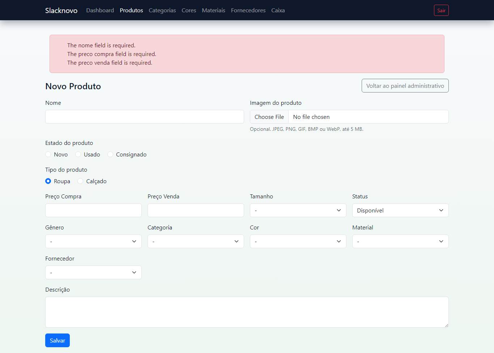 | 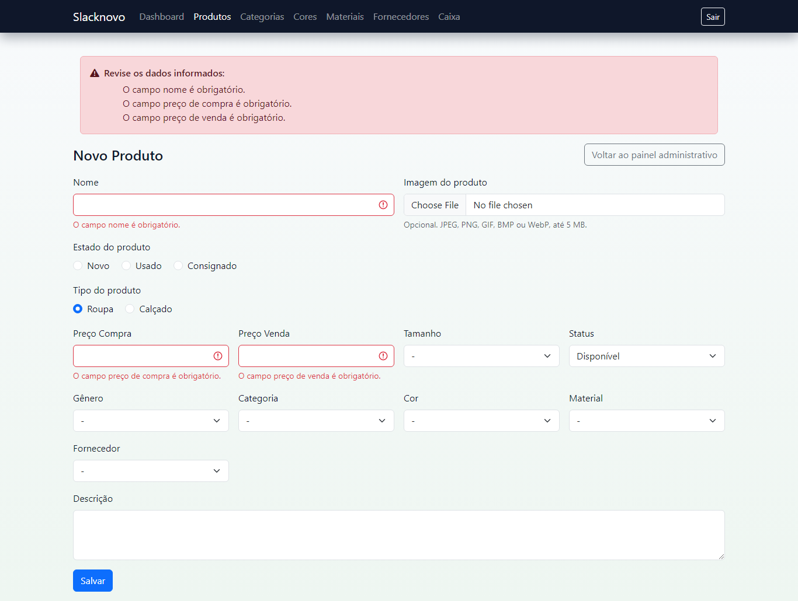 |
| Validação do caixa (desktop) | 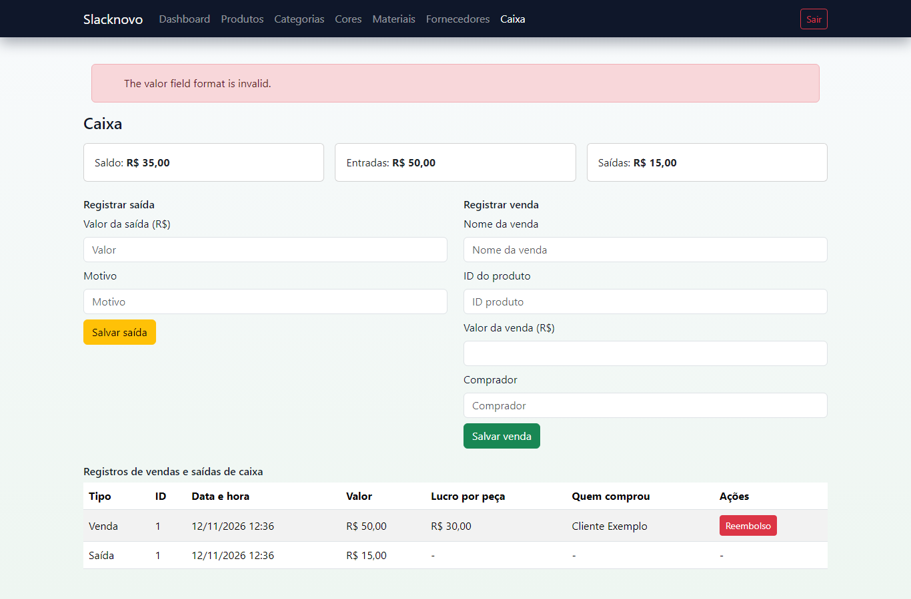 | 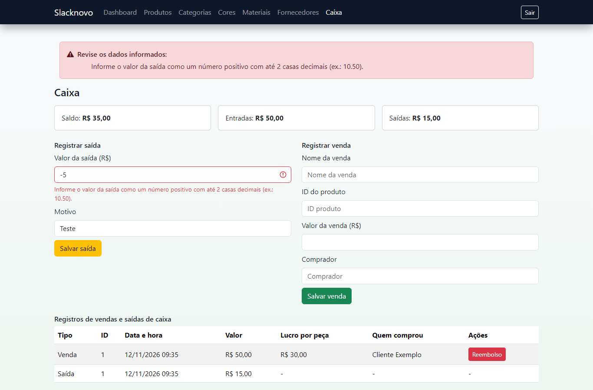 |
| Categorias (celular) | 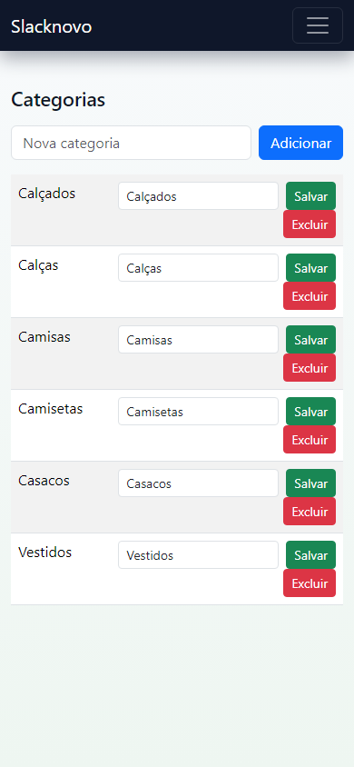 | 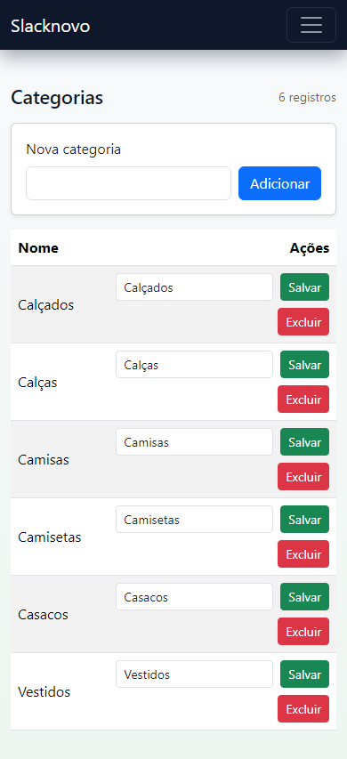 |
| Primeiro Tab (desktop) | 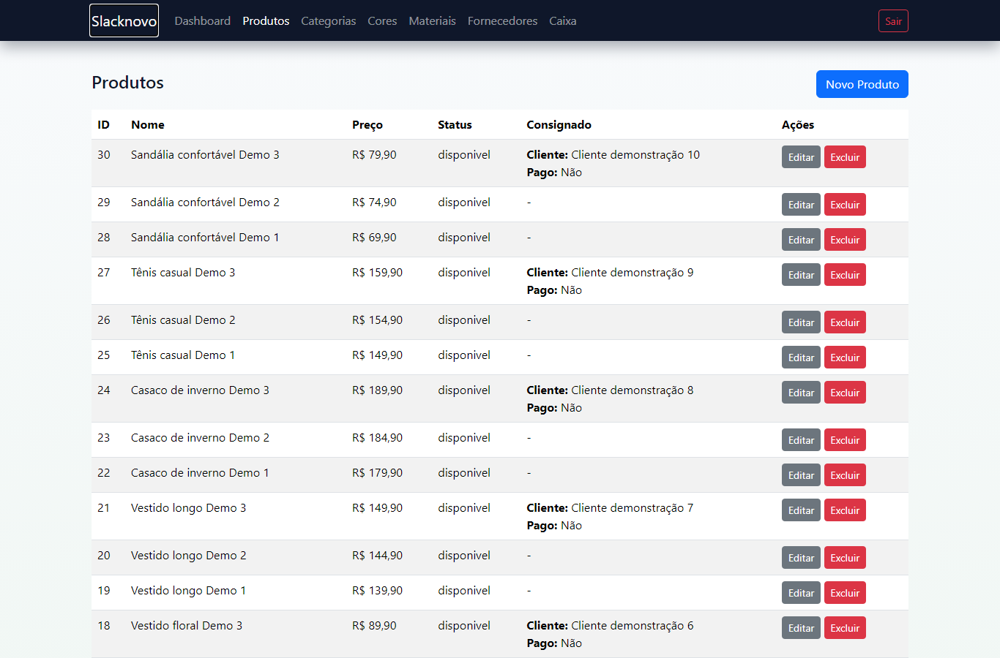 | 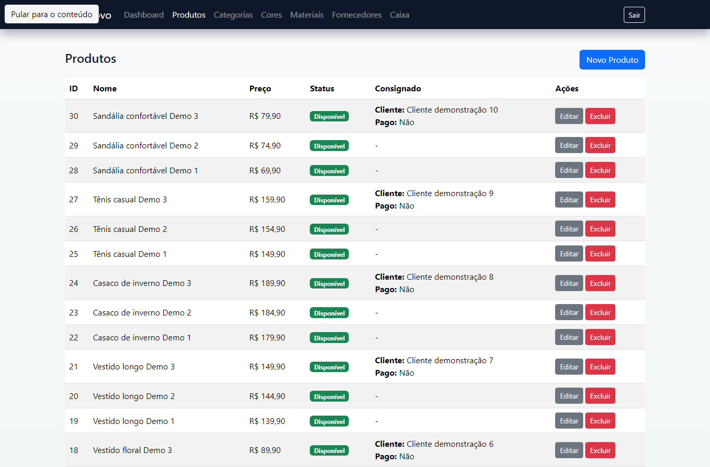 |
| Caixa (desktop) | 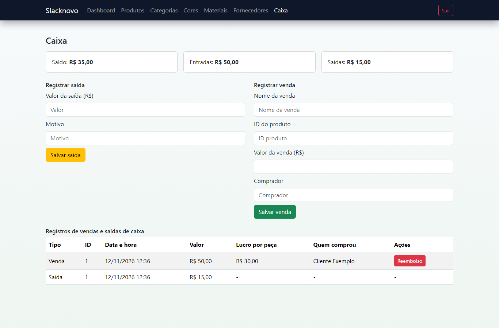 | 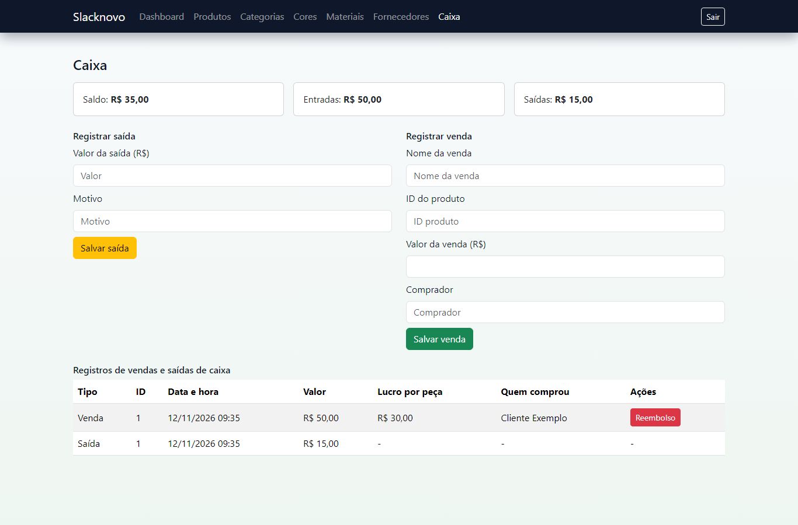 |
| Menu aberto (celular) | 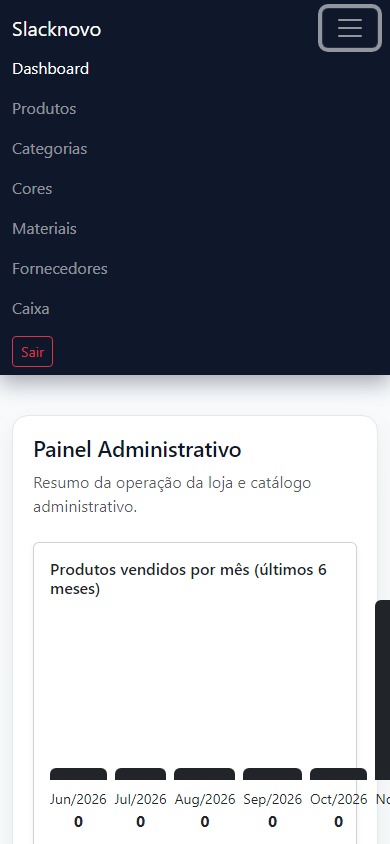 | 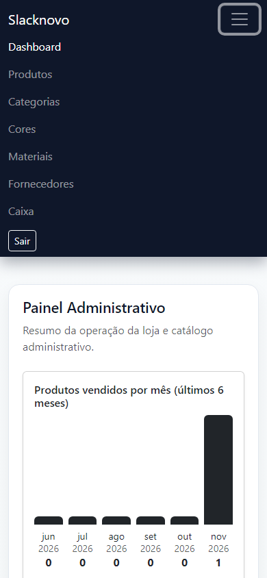 |

Dashboard no celular: [antes](evidencias/SLK-09/navegador/antes/mobile-dashboard.png) (página inteira, ~8.200 px) e [depois](evidencias/SLK-09/navegador/depois/mobile-dashboard.png) (24 itens e paginação).

## 6. Validação

### 6.1 PHPUnit

| Execução | SQLite `:memory:` | MySQL 8.4.9 (\*) |
| --- | --- | --- |
| `main` @ `bbaddcc` | `OK (81 tests, 1400 assertions)` | `OK (69 tests, 645 assertions)` |
| `ui/slk-09-acessibilidade-formularios` | `OK (84 tests, 1430 assertions)` | `OK (72 tests, 675 assertions)` |
| `ui/slk-09-mensagens-validacao-ptbr` | `OK (88 tests, 1443 assertions)` | `OK (76 tests, 688 assertions)` |
| `ui/slk-09-responsividade-dashboard` | `OK (85 tests, 1419 assertions)` | `OK (73 tests, 664 assertions)` |
| `ui/slk-09-padroniza-componentes` | `OK (96 tests, 1477 assertions)` | `OK (84 tests, 722 assertions)` |
| Integração das 4 branches (merge temporário, sem conflitos) | `OK (110 tests, 1569 assertions)` | `OK (98 tests, 814 assertions)` |
| Integração SLK-09 + SLK-07 (4 + 3 branches, sem conflitos) | `OK (125 tests, 1630 assertions)` | `OK (113 tests, 875 assertions)` |

(\*) No MySQL, o `AuthenticationSecurityTest` (12 testes) é excluído porque exige SQLite por desenho, como na `main`.

O Pint passou nos arquivos PHP alterados de cada branch. Os logs estão em [`evidencias/SLK-09/testes/`](evidencias/SLK-09/testes/).

### 6.2 Navegador

- **Auditoria:** [`scripts/auditoria-ui.cjs`](evidencias/SLK-09/scripts/auditoria-ui.cjs), com Playwright 1.49.1 (Chromium headless) e axe-core 4.10.2, regras `wcag2a`, `wcag2aa`, `wcag21a` e `wcag21aa`. Cobre 11 telas em 1366 × 900 e 390 × 844, mais menu, teclado e mensagens.
- **Resultados brutos:** [`auditoria-antes.json`](evidencias/SLK-09/navegador/auditoria-antes.json) e [`auditoria-depois.json`](evidencias/SLK-09/navegador/auditoria-depois.json).

| Verificação | Antes | Depois |
| --- | --- | --- |
| axe `label` (cadastros auxiliares) | 48 | 0 |
| axe `color-contrast` ("Sair") | 9 | 0 |
| axe `select-name` (filtros do dashboard) | 6 | 0 |
| Vazamento horizontal | 1 tela (46 px) | 0 |
| Menu no celular: abre, `aria-expanded="true"` e links visíveis | ✅ | ✅ |
| Erros de JavaScript (`pageerror`) | 0 | 0 |

- **Aceite do projeto:** `tests/Browser/acceptance.cjs` concluiu os 4 cenários (catálogo, login e edição, caixa com venda, reembolso e saída, e mobile com menu e logout), tanto com a correção da ferramenta sobre a `main` quanto na integração das 4 branches. Veja `testes/acceptance-*.txt`.

## 7. Rastreabilidade

| Mudança | Branch (local) | Commits | Teste | PR |
| --- | --- | --- | --- | --- |
| UI-01 Acessibilidade e navegação | `ui/slk-09-acessibilidade-formularios` | `510acd6` | `InterfaceAccessibilityTest` | Pendente de autorização |
| UI-02 Mensagens, feedback e fuso | `ui/slk-09-mensagens-validacao-ptbr` | `1feb7b7`, `1a45348` | `InterfaceFeedbackMessagesTest`, `ReviewRegressionTest` | Pendente de autorização |
| UI-03 Responsividade do dashboard | `ui/slk-09-responsividade-dashboard` | `2499aa6`, `a45ab02` | `DashboardResponsiveTest` | Pendente de autorização |
| UI-04 Componentes e estados | `ui/slk-09-padroniza-componentes` | `d1f60db` | `StandardComponentsTest`, `FunctionalAcceptanceTest` | Pendente de autorização |
| Ferramenta de aceite no Windows + este relatório | `docs/slk-09-relatorio-ui` | `8a49f0c` e o commit deste relatório | `tests/Browser/acceptance.cjs` | Pendente de autorização |

**Ordem de merge sugerida:** UI-01 → UI-02 → UI-03 → UI-04 → docs. Todas as combinações testadas mesclaram sem conflito, inclusive com as branches da SLK-07. Depois da publicação, preencher aqui as URLs de branches, commits e PRs.

**Itens do backlog da SLK-07 resolvidos aqui:** BUG-13 (UI-04), BUG-16 (UI-02) e BUG-17 (UI-02, só na exibição). A paginação do dashboard (parte do BUG-11) está na UI-03; a lista do caixa continua sem paginação.

## 8. Limitações

- O celular foi emulado no Chromium (390 × 844). Não houve teste em aparelho físico, Safari ou Firefox.
- Não houve teste manual com leitor de tela (NVDA ou VoiceOver). O axe cobre só as regras automatizáveis da WCAG; foco, ordem de leitura e textos alternativos foram conferidos apenas nos pontos citados.
- O catálogo público só recebeu o link para pular ao conteúdo. Os contatos reais (UX-08) continuam dependendo do negócio.
- Quem já tem `.env` com `APP_LOCALE=en` precisa trocar para `pt_BR`; o `.env.example` já vem atualizado.
- A lista do caixa continua carregando todos os registros (BUG-11, parcial).

## 9. Próximos passos (dependem de autorização)

1. Publicar as 5 branches e abrir um PR por branch com destino `main`, na ordem da seção 7.
2. Revisão visual e técnica pela equipe, que é o critério de aceite.
3. Preencher na seção 7 os links dos PRs, branches e commits.
